


 

<code>DESENVOLVER · INVESTIGAR · AUTOMATIZAR · EVOLUIR</code>

<a href="https://www.linkedin.com/in/atarasilva/">LinkedIn</a> &nbsp;·&nbsp;
<a href="mailto:dev.tec@outlook.com.br">Vamos conversar</a> &nbsp;·&nbsp;
<a href="https://github.com/atararossatti?tab=repositories">Explore meus projetos</a>

 

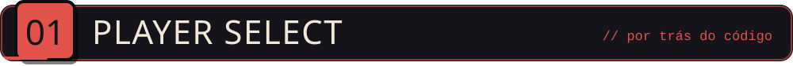

  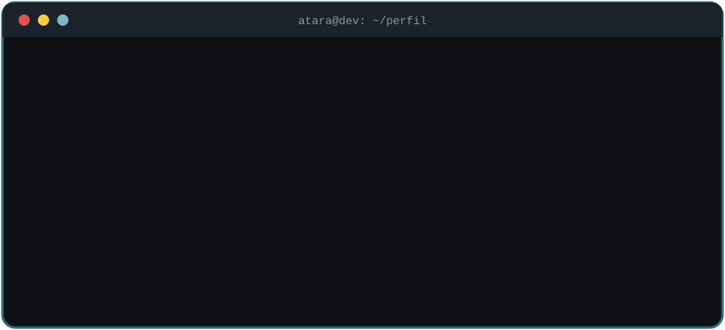

 

Gosto de entender como as coisas funcionam, investigar problemas e transformar ideias em soluções úteis. Minha trajetória reúne **desenvolvimento web, qualidade de software, implantação, suporte técnico, segurança da informação e UX/UI**.

Na **ELEV Tecnologia**, minha experiência passa pelo desenvolvimento de aplicações, suporte N1 e N2, implantação e QA. Essa vivência me ajuda a conectar o código com a experiência de quem usa o sistema: entender a necessidade, investigar a causa e validar se a solução funciona no dia a dia.

Hoje, estou ampliando meus conhecimentos em **Inteligência Artificial, IA Generativa e Machine Learning**, com foco em aplicações práticas, assistentes e automação de processos.

| 🎯 Habilidade | Como aparece na prática |
| --- | --- |
| 🔎 **Detetive de bugs** | Investigo bugs, valido regras de negócio e documento evidências para melhorar a qualidade das entregas. |
| ⚙️ **Conector de sistemas** | Trabalho com integrações, APIs e automação de atendimento. |
| 🧩 **Pé no código, olho no usuário** | Combino desenvolvimento, usabilidade e resolução de problemas. |
| 🤝 **Jogo em equipe** | Tenho experiência em equipes multidisciplinares e participação em hackathons. |
| 🌱 **Missão atual** | Estou construindo minha trajetória em **AI Engineer / Generative AI Engineer / Machine Learning Engineer**. |

 

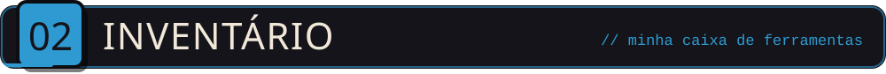

 

| 🎒 Slot | O que tem dentro |
| --- | --- |
| 🌐 **Desenvolvimento Web** | JavaScript, HTML, CSS, PHP, Node.js, interfaces responsivas, manutenção de aplicações e correção de bugs. |
| 🔌 **APIs e integrações** | Consumo e desenvolvimento de APIs, integração entre sistemas e análise de requisições e respostas. |
| 🕵️ **Quality Assurance** | Testes funcionais, exploratórios, de regressão e de API; cenários de teste, homologação, evidências e acompanhamento de defeitos. |
| 📊 **Dados e produtividade** | SQL, consultas com DBeaver e Excel avançado, incluindo macros e ferramentas do Modo Desenvolvedor. |
| 🛡️ **Infraestrutura e segurança** | Linux, máquinas virtuais em GCP e Oracle Cloud, configuração de firewall, balanceamento de carga e segurança da informação. |
| 🎧 **Implantação e suporte** | Troubleshooting, configuração de e-mail, telefonia, PBX, URA e plataformas de atendimento. |
| 💬 **Automação de atendimento** | Fluxos com Typebot, integrações com WhatsApp Business/API oficial e melhoria de processos. |
| 🎨 **UX/UI e colaboração** | Figma, prototipação, usabilidade, Git, GitHub, GitLab, metodologias ágeis e conhecimentos de ITIL. |

 

  

 

Estou direcionando meus estudos e projetos pessoais para a criação de soluções com IA, aproveitando minha base em desenvolvimento, integrações e qualidade de software.

<b>🧪 Ver o que estou estudando em detalhe</b>

 

**Conhecimentos em desenvolvimento:**

- **Python e Jupyter Notebook:** estudos de programação e experimentação.
- **LLMs e IA generativa:** compreensão de modelos de linguagem e suas aplicações em chats, assistentes e atendimento.
- **Hugging Face:** exploração do ecossistema de modelos e das famílias Qwen, Llama, Mistral e Gemma.
- **Integração de IA em aplicações:** estudos sobre APIs de modelos, inferência e consumo de tokens.
- **Automação assistida por IA:** exploração de fluxos para transcrição, organização de informações e redução de tarefas repetitivas.

**Próximos aprofundamentos:** fundamentos de Machine Learning, preparação de dados, treinamento e avaliação de modelos, RAG e disponibilização de soluções de IA em aplicações.

> 💜 **Meu objetivo:** unir desenvolvimento e QA para construir aplicações de IA úteis, com atenção à qualidade das respostas, à experiência do usuário e à segurança dos dados.

 

**⚡ Automação e IA aplicada.** Tenho explorado projetos pessoais de automação de fluxos para afiliados, transcrição de reuniões com IA e apoio às atividades de QA. São iniciativas em evolução, nas quais conecto problemas do cotidiano com desenvolvimento e experimentação.

 

<table align="center">
  <tr>
    <td align="center" width="33%">
       
      <b>🦙 Lhama Impact</b> 
      Projeto do meu portfólio de desenvolvimento e design.
    </td>
    <td align="center" width="33%">
       
      <b>🗺️ Turismo São Paulo</b> 
      Aplicativo de turismo desenvolvido no contexto de hackathon.
    </td>
    <td align="center" width="33%">
      <a href="https://github.com/atararossatti?tab=repositories">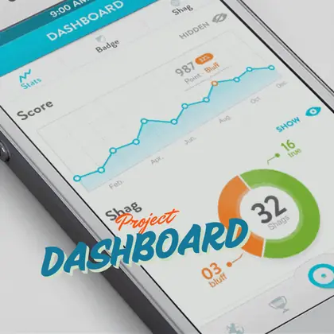</a> 
      <b>📈 Dashboard</b> 
      Projeto de interface para visualização de informações.
    </td>
  </tr>
</table>

Clique em um card para explorar os repositórios →

 

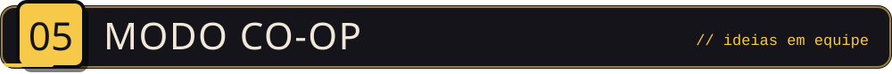

| 🏆 Missão | O que rolou |
| --- | --- |
| 📡 **Hackathon Anatel** | Participação no desafio relacionado a TV Boxes ilegais. [Sobre o evento](https://g1.globo.com/sp/sao-paulo/noticia/2024/09/29/apos-promover-desafio-anatel-seleciona-3-melhores-solucoes-para-acabar-com-tv-boxes-ilegais.ghtml) |
| 🏙️ **Hackathon Visite São Paulo** | Participação em projeto de aplicativo para turismo em São Paulo. [Registro da participação](https://www.linkedin.com/feed/update/urn:li:activity:7257178025828491265/) |

 

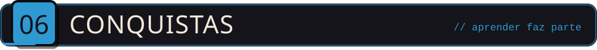

<a href="https://www.credly.com/badges/8ebc4ed7-fc22-40ac-905b-3aeadc437996/public_url">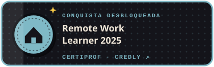</a>
<a href="https://www.credly.com/badges/eb37ba60-d984-4580-adea-1f1ce2abac09/public_url">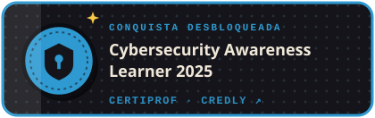</a>
 
<a href="https://www.credly.com/badges/2314d46d-07d5-4dad-a4a8-0b4aa8e13ab8/public_url">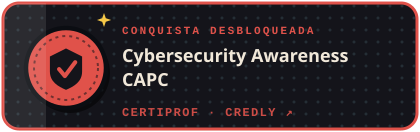</a>

 

Clique em um card para abrir a credencial.

 

 

🎮 <code>↑ ↑ ↓ ↓ ← → ← → B A</code>

 
<b>Cheat code ativado: +1 vida 💜</b> 
Obrigada por ler até aqui! Se quiser trocar ideia sobre QA, automação ou IA, é só chamar.

 

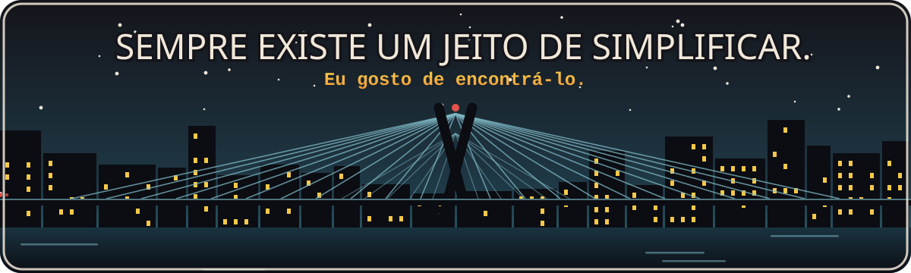
